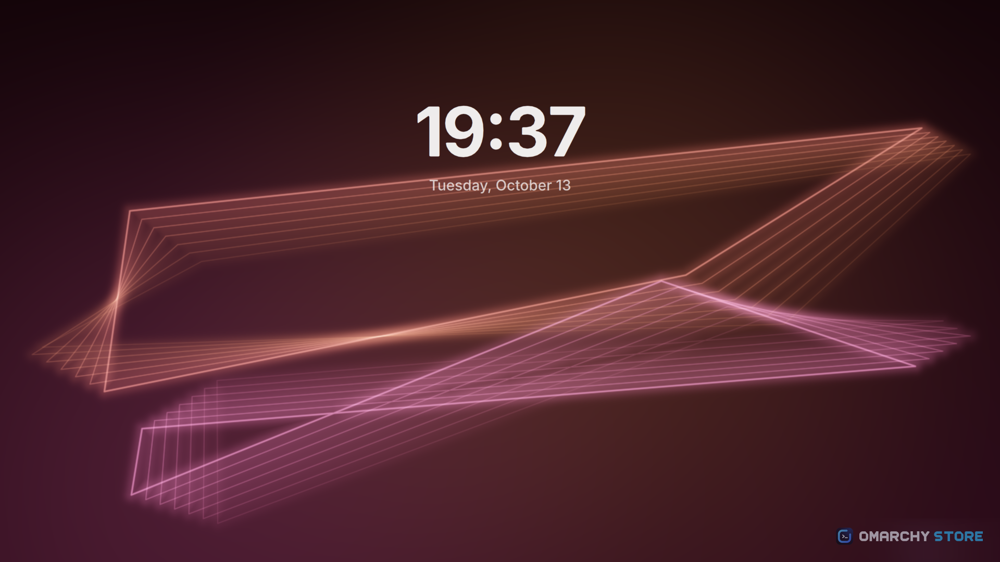

# Omarchy Store Screensaver

Developed by Kernlux Development Labs. An independent community project. The official screensaver of the [Omarchy Store](https://omarchystore.com): glowing Mystify-style ribbons
drifting over a soft aurora, with a clock that gently moves so nothing burns into your screen.



## Install

From the Omarchy Store: open **Screensavers** and press **GET**.

Or in a terminal:

```bash
omarchy plugin add https://codeberg.org/kernlux/omarchy-store-screensaver.git --enable
```

Or download the release file `omarchy-store-screensaver-1.3.0.tar.gz` from the
[Codeberg releases](https://codeberg.org/kernlux/omarchy-store-screensaver/releases) and check it first:

```bash
cd ~/Downloads && echo "576e8cf1faca73ba2d50a09a4377ec2b7dbe84a2de21fa95386bedf70c3d23f9  omarchy-store-screensaver-1.3.0.tar.gz" | sha256sum -c
```

What it contains: QML files, one shader and four images. No install script, no network access, no password prompt,
nothing runs as root. While it runs it calls a few fixed local commands (no shell): `omarchy-system-lock` and
`omarchy-shell lock` for the optional password on wake, `hyprctl` to hide the cursor, and `mkdir`/`touch`/`rm` on its
own files in your home folder (`~/.local/state/omarchy/toggles`, `~/.local/share/applications`). Read them in
`Service.qml` and `Settings.qml`.

## Settings

Open **Screensaver Settings** from the app launcher (Super + Space), or run
`omarchy-shell shell summon omarchy-store-screensaver`.

- **10 colour palettes**: Aurora, Omarchy Store, Sunset, Ocean, Forest, Ember, Candy, Classic Mystify, Silver,
  and *My Omarchy theme* (follows whatever theme you're using)
- **Start after**: 1 minute to 1 hour
- **Ask for my password when I come back**: locks the computer when the screensaver ends
- Clock on/off, speed (Calm / Normal / Lively), 1–3 shapes
- **Preview full screen** to see it straight away

Any key, click or mouse movement wakes it. *Stay Awake* in the Omarchy menu pauses it, and so does anything
that keeps the screen on (videos, presentations).

While it's on, it replaces Omarchy's text screensaver; switch it **Off** in Settings (or remove the plugin) and
Omarchy's original comes back.

## Remove

```bash
omarchy plugin remove omarchy-store-screensaver
```

## Source

- Codeberg (main): https://codeberg.org/kernlux/omarchy-store-screensaver
- GitHub (read-only mirror): https://github.com/Kernlux/omarchy-store-screensaver

Security reports: security@kernlux.com

## License

MIT, Copyright (c) 2026 Kernlux Development Labs. See [LICENSE](LICENSE).
